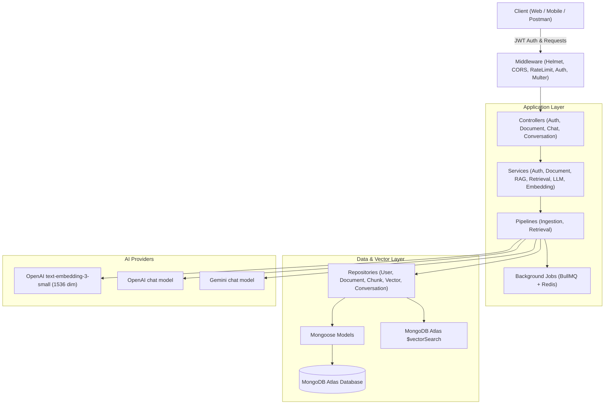
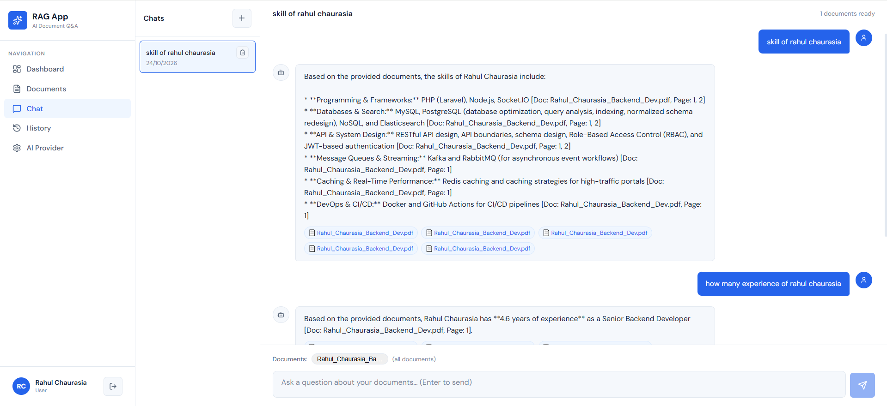
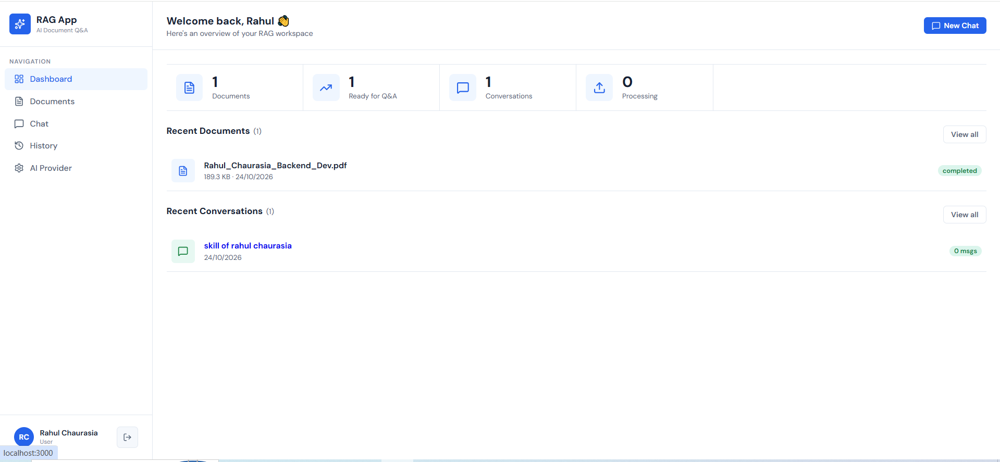

# Production-Ready RAG Application

A modular, secure, high-performance Retrieval-Augmented Generation (RAG) backend built with **Node.js**, **Express.js**, **Mongoose / MongoDB Atlas Vector Search**, and OpenAI or Gemini.

Designed following strict **MVC + Service Layer + Repository Pattern** principles.

---

## 1. System Architecture

---

## 3. Technology Stack & Key Highlights

- **Backend Framework**: Node.js v18+ with Express.js (CommonJS).
- **Database**: MongoDB Atlas using Mongoose 8.x.
- **Vector Search**: MongoDB Atlas Vector Search using `$vectorSearch` aggregation stage.
- **Embeddings**: OpenAI API (`text-embedding-3-small`, 1536 dimensions) to keep vectors compatible with the configured Atlas index.
- **Answer generation**: Per-user OpenAI or Gemini API key, configured under **AI Provider** in the app.
- **Parsing**: `pdf-parse` (PDF with page retention), `mammoth` (DOCX), and native text stream (TXT).
- **Chunking**: Natural sentence boundary detection with configurable chunk size and overlap.
- **Security & Hardening**:
  - Helmet for secure HTTP headers.
  - Rate limiting (100 req/15 min).
  - Explicit CORS policy.
  - Strict Zod validation on all incoming payload bodies, queries, and params.
  - Full tenant isolation: users can only view, query, or delete their own documents and conversations.
  - Prompt Injection Defense: Retrieved chunks are treated as untrusted data in LLM prompt templates.
  - Pino logger with automatic redaction of passwords, tokens, API keys, and sensitive vectors.
- **Testing**: Jest + Supertest with `mongodb-memory-server` for instant, isolated, cost-free tests without requiring paid OpenAI credentials.

📸 Project Screenshot

